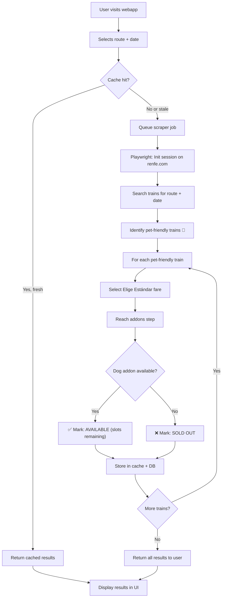

# 🐕 Renfe Big Dog Spot Availability Checker — Technical Investigation

> **Goal:** Build a webapp that lets users quickly find which Renfe trains (AVE, AVLO, Alvia, Euromed, Intercity) have **available spots for large dogs (10–40 kg)** — without going through the entire booking process each time.

---

## Table of Contents

1. [The Problem](#the-problem)
2. [Renfe Dog Policy — The Rules](#renfe-dog-policy--the-rules)
3. [Real-World Findings & Route Case Study (Madrid – Sevilla)](#real-world-findings--route-case-study-madrid--sevilla)
4. [Available Data Sources & APIs](#available-data-sources--apis)
5. [Architecture Approaches](#architecture-approaches)
6. [Recommended Architecture](#recommended-architecture)
7. [Implementation Plan](#implementation-plan)
8. [Legal & Ethical Considerations](#legal--ethical-considerations)
9. [Risk Assessment](#risk-assessment)

---

## The Problem

Renfe allows large dogs (10–40 kg) on certain high-speed and long-distance trains, but the booking experience is **terrible** for dog owners:

1. You search for trains on [renfe.com](https://renfe.com)
2. Some trains show a 🐾 paw icon indicating they're "pet-friendly"
3. You select a train, choose the "Elige Estándar" fare (the only one that allows large dogs)
4. You fill in passenger details
5. **Only at the extras/addons step** — near the end of checkout — do you discover if the "Perros hasta 40 kg" addon is available
6. If it's sold out (only **2 spots per train**), you must **go back** and repeat the entire process with another train

This is the core pain point. **Our app solves it by checking large dog availability upfront**, before the user commits to a booking flow.

---

## Renfe Dog Policy — The Rules

### Small Dogs (≤ 10 kg)
- ✅ Allowed on **all** Renfe trains
- Must travel inside an enclosed carrier (max **60×35×35 cm**, waterproof base)
- Max **1 pet per passenger**, stays at feet or on lap — does NOT occupy a seat

| Train type | Price |
|---|---|
| AVE, Alvia, Euromed, Intercity (Básico/Elige) | **€10** |
| AVE, Alvia, Euromed, Intercity (Prémium) | **Free** (must add to booking) |
| Avlo | **€10** |
| Avant / Media Distancia | **25% of general fare** |
| Cercanías / Rodalies / Feve | **Free** |

### Large Dogs (10–40 kg) — "Perros hasta 40 kg"

#### Compatible train types
| ✅ Allowed | ❌ NOT allowed |
|---|---|
| AVE (domestic) | Ouigo (competitor, ≤10kg only) |
| AVLO | Iryo (competitor, ≤10kg only) |
| Alvia | Feve / Ancho Métrico |
| Euromed | Trains with road transfers |
| Intercity | |
| Avant | |
| Media Distancia | |

#### Fare requirements
| Train type | Required fare | Blocked fares |
|---|---|---|
| AVE / Larga Distancia | **Elige Estándar** | Básico (no addon option), Prémium (no large dogs) |
| AVLO | **Básica** | — |
| Avant / Media Distancia | General fare | — |

#### Pricing
- **€40 per trip** on commercial services (AVE, Avlo, Alvia, Euromed, Intercity)
- **General fare equivalent** on Avant / Media Distancia

#### Capacity — THE critical constraint
- **Maximum 2 large dogs per train** (the entire convoy)
- Fixed in a specific pre-configured **pet-friendly coach** (e.g., Coach 7 in AVE)
- The dog gets the **window seat**, the passenger gets the **aisle seat** (auto-assigned, no manual selection)
- Max **1 large dog per passenger**

#### Restrictions
- ❌ Puppies under **1 year old** (< 12 months)
- ❌ Females **in heat** (*en celo*)
- ❌ **PPP breeds** (Perros Potencialmente Peligrosos) and crossbreeds thereof
- Must book at least **24 hours before departure** (cannot book same-day)

#### Requirements on board
- **Muzzle:** Mandatory in stations, platforms, boarding. Can be removed once seated if dog is calm
- **Leash:** Non-extensible, max **1.5m**, tied to seat/footrest
- **Documents:** Vaccination booklet or EU Pet Passport + Civil Liability Insurance + Signed Responsible Declaration
- **Arrival:** Must be at station's *Centro de Servicios* at least **40 minutes** before departure
- **Seat kit:** Renfe provides protective seat cover + floor mat (collected at Centro de Servicios)
- **Cleaning kit:** Owner must bring wipes, poop bags, disinfectant

### The Exact Booking Flow & Where Availability Is Revealed

```
Step 1: SEARCH FORM                 → No pet filter exists. Search as standard passenger.
Step 2: TRAIN RESULTS LIST          → 🐾 paw icon shown on compatible trains
                                       ⚠️ This icon ONLY means the train TYPE supports pets
                                       ⚠️ It does NOT indicate available slots!
                                       ⚠️ Both spots can be sold out and the paw still shows!
Step 3: FARE SELECTION              → Must select "Elige Estándar" (AVE/LD) or "Básica" (Avlo)
                                       Choosing "Básico" locks out the large dog addon entirely
Step 4: PASSENGER INFO + EXTRAS     → ✅ THE ONLY STEP where real-time availability is shown
         "Personaliza tu viaje"        If available: "Perros hasta 40 kg" checkbox (+€40) is clickable
         "Complementos"               If sold out: Greyed out / "Agotado" / "No disponible" / disappears
```

> [!CAUTION]
> **The Deceptive Paw Icon:** The 🐾 icon on the search results page is a **static indicator** of train-type capability, NOT real-time seat inventory. Users constantly get their hopes up, go through 3 steps of the booking funnel, only to find "Agotado" at Step 4. For round-trip bookings, you must find overlapping availability on BOTH legs — if one doesn't have a spot, the entire booking tears down.

### Why This Is So Painful (User Reports)

From Spanish dog-travel communities (SrPerro, Pipper on Tour, Reddit r/Espana):

1. **Blind trial-and-error:** On popular corridors (Madrid–Barcelona, Madrid–Sevilla, Madrid–Málaga), the 2 spots sell out **weeks/months** in advance. Checking 15 trains on a single day = clicking through 15 complete booking funnels.
2. **Round-trip nightmare:** Must find matching availability on both legs simultaneously.
3. **No alerts or waitlist:** If someone cancels, the spot reappears silently. The only way to catch it is manual refresh loops.
4. **24-hour cutoff:** Even if spots are empty, booking closes 24h before departure.

---

## Real-World Findings & Route Case Study (Madrid – Sevilla)

During live testing against Renfe's booking engine for the **Madrid - Sevilla** corridor, we mapped the exact reasons why users struggle to find any available spot and identified the real availability patterns:

### 1. The 4 Structural Barriers to Finding a Spot

#### A. The 24-Hour Cutoff Rule (Antelación obligatoria)
Renfe strictly disables large dog bookings with **less than 24 hours of advance notice**:
- Searching for the same day or next morning will **always** fail, even if the 2 dedicated pet seats are completely vacant.
- The addon checkbox is disabled or removed by the server once the 24-hour cutoff passes.

#### B. The 2-Spot Capacity Bottleneck on High-Density Corridors
In an entire AVE convoy (350+ passenger capacity), **only 2 large dog spots exist** (paired seats in Coach 7):
- Madrid – Sevilla is one of Spain's busiest business and tourist rail corridors.
- Weekend trains (Friday afternoon, Sunday evening) and peak morning departures regularly sell out their 2 pet spots **3 to 6 weeks in advance**.

#### C. The Silent Carriage ("Coche en Silencio") Incompatibility Trap
Renfe rules strictly forbid large dogs in quiet coaches:
- If a user selects the **"Elige"** fare, but the only remaining Elige seats are in a quiet coach (*Coche en Silencio*), an warning modal triggers (`La petición implica viajar en coche de tipo en silencio...`), and the dog addon is **permanently blocked**.
- Only standard coach Elige tickets allow attaching the pet addon.

#### D. The Deceptive Static Paw Icon (🐾) Trap
Live inspection of `venta.renfe.com/vol/buscarTrenEnlaces.do` confirmed that **almost every AVE train on Madrid - Sevilla displays `huella_perro.gif`** on the initial schedule page:
- This leads travelers into a repetitive loop: they see the paw icon on 10–15 trains in a row, click through the fare and passenger steps, only to discover "Agotado" at Step 4 every time.

---

### 2. When & Where Spots Can Actually Be Found

Based on demand patterns and live inventory checks:

| Factor | High Availability (Spot Found) | Low Availability (Usually Sold Out) |
|---|---|---|
| **Day of Week** | **Tuesday & Wednesday** (Lowest leisure travel) | **Friday & Sunday** (Sold out 4–6 weeks ahead) |
| **Departure Time** | **Early morning** (06:05 – 07:18) or **Night** (20:00 – 21:05) | **Peak hours** (09:00 – 13:00, 17:00 – 19:30) |
| **Booking Horizon** | **10 to 15 days ahead** for weekdays; **3 to 5 weeks ahead** for weekends | < 7 days ahead |
| **Cancellation Window** | **48 to 72 hours before departure** (Travelers cancel/change tickets, silently returning slots to the pool) | Last 24 hours (Booking locked) |

> [!TIP]
> **Catching Last-Minute Openings:** Because spots are frequently freed by travelers changing flexible "Elige" tickets 2 to 3 days before travel, an automated background monitor (or Telegram bot) polling every 15–30 minutes is the single most effective way to grab a ticket on a sold-out date.

---

### 3. Live Reverse-Engineered Renfe DOM Selectors

From our live network and Playwright inspection of `renfe.com` and `venta.renfe.com`:

```python
# ── Homepage search widget ──
ORIGIN_INPUT = "#origin"                                # Input for origin station
DESTINATION_INPUT = "#destination"                      # Input for destination station
AUTOCOMPLETE_OPTION = "[role='option']"                 # Dropdown option (Awesomplete)
DATE_INPUT = "#first-input"                             # Readonly date field for outbound
SEARCH_SUBMIT = "button:has-text('Buscar billete')"     # Primary submission button

# ── Results & Fare Selection (venta.renfe.com) ──
RESULTS_URL = "https://venta.renfe.com/vol/buscarTrenEnlaces.do"
DWR_ENDPOINT = "trainEnlacesManager.getTrainsList.dwr"  # Direct Web Remoting RPC
PET_ICON = "img[src*='huella_perro']"                   # Visual capability indicator
EXPANDED_FARE_SPAN = "span.precio-cards"                # Clickable fare price pills (Elige, Básico)
SELECT_BUTTON = "button:has-text('Seleccionar')"        # Advances to checkout Step 2
WARNING_MODAL_CLOSE = "button.close, [aria-label='Cerrar']"
```

---

## Available Data Sources & APIs

### 1. Renfe Official — No Public API ❌

Renfe does **NOT** offer a public developer API for ticket booking or availability checking.

| What exists | Details |
|---|---|
| **Real-time fleet tracker** | `https://tiempo-real.largorecorrido.renfe.com/renfe-visor/flotaLD.json` — unauthenticated JSON endpoint showing live GPS positions of all long-distance trains. No availability data. |
| **Station data (GTFS)** | Renfe publishes some static GTFS data with station codes and schedules |
| **Open data portal** | [datos.renfe.com](https://datos.renfe.com) — station lists, line geometries. No commercial availability. |
| **Booking website** | `venta.renfe.com` — SPA with heavy anti-bot protection (Akamai/Cloudflare). Internal REST endpoints exist but are undocumented and protected. |

#### Renfe's Internal Booking Flow (Reverse-Engineered)

```
Phase 1: Station autocomplete → station codes (e.g., 60000 = Madrid Atocha)
Phase 2: POST search → train list with times, prices, products, petFriendly flag
Phase 3: Select train + fare → session/cart token
Phase 4: Passenger details + seat map
Phase 5: Ancillaries/addons → HERE is where dog availability is checked
Phase 6: Payment gateway (Redsys/3D Secure)
```

**The dog addon availability is checked in Phase 5**, which requires completing phases 1–4 first. The addon is likely internally named something like `ADDON_PERRO_40KG` and the system validates stock in real-time against the 2-slot quota for the pet-friendly coach.

#### Real-time Fleet JSON Structure (from `flotaLD.json`)

```json
{
  "fechaActualizacion": "2026-10-15T00:03:35",
  "trenes": [
    {
      "codComercial": "02200",       // Train number
      "codProduct": 2,               // Product code (2 = AVE)
      "codOrigen": "60000",          // Origin station code
      "codDestino": "51003",         // Destination station code
      "codEstAnt": "50500",          // Previous station
      "codEstSig": "51003",          // Next station
      "horaLlegadaSigEst": "...",    // Next arrival time
      "accesible": false,            // Accessibility
      "ultRetraso": "93",            // Delay in minutes
      "latitud": 37.502293,
      "longitud": -5.914968,
      "mat": "103021"               // Rolling stock unit
    }
  ]
}
```

> **Note:** This endpoint has NO pet/dog availability data. It's only useful for knowing which trains are currently running.

---

### 2. RadarDeTrenes API ✅ (Partial — no booking data)

[radardetrenes.com](https://radardetrenes.com) provides a **free, public, read-only API** aggregating Renfe/ADIF real-time data.

| Feature | Details |
|---|---|
| **Base URL** | `https://radardetrenes.com/api/v1` |
| **Auth** | None required (optional bearer token) |
| **Rate limit** | 100 req/s per IP |
| **CORS** | Enabled (`*`) |
| **OpenAPI spec** | `https://radardetrenes.com/api/openapi.json` |
| **MCP server** | Available at `/mcp` for AI agent integration |

#### Key Endpoints

| Endpoint | Use |
|---|---|
| `GET /api/v1/fleet?type=ld` | Live fleet positions (200+ trains) |
| `GET /api/v1/fleet/stream?type=ld` | SSE stream of fleet updates (~20s) |
| `GET /api/v1/stations` | Full station catalogue with codes, coords |
| `GET /api/v1/stations/{code}/board-renfe` | Departure/arrival boards |
| `GET /api/v1/trains/{id}/route` | Scheduled stops + polyline geometry |
| `GET /api/v1/trains/{id}/stops` | Detailed itinerary with delays |
| `GET /api/v1/rolling-stock` | Technical catalogue of train series |
| `GET /api/v1/stats/train/{code}` | Punctuality statistics |

> **Limitation:** RadarDeTrenes provides operational/tracking data, NOT commercial availability or booking data. It cannot tell us about dog spots.

**However**, it's extremely useful for:
- Getting the list of trains on a route
- Station codes and names
- Train types/products
- Real-time tracking data for the UI

---

### 3. GitHub Community Projects 🔧

Several open-source projects tackle Renfe scraping:

| Project | Tech | Purpose |
|---|---|---|
| **emartinez-dev/renfe-bot** | Python, Selenium/Playwright, Telegram | Ticket availability monitor + alerts |
| **fervillarce/your-renfe-tickets-are-available** | Python | Email alerts when tickets open |
| **grcanosa/renfe-notifier-bot** | Python | Slot availability tracker |
| **belgrano9/renfe_mcp_server** | Python, MCP | AI-queryable Renfe schedule data |

> **Key takeaway from these projects:** All of them use **headless browser automation** (Playwright/Selenium) to interact with Renfe's website, because the direct API endpoints are heavily protected with anti-bot measures. Pure HTTP requests to the booking backend frequently get blocked.

---

### 4. Third-Party Aggregators

| Service | Notes |
|---|---|
| **Trainline** | Sells Renfe tickets but doesn't expose pet addon availability in search |
| **Omio** | Same limitation |
| **Lyko** | Rail aggregator API — may have `petFriendly` filters but unclear addon-level data |

---

## Architecture Approaches

### Approach A: Headless Browser Scraper (Playwright) ⭐ Recommended

**How it works:** Use Playwright to automate the full Renfe booking flow up to the addon step, extract dog availability, and cache results.

```
┌─────────────────────────────────────────────────────────┐
│                    Our Web App (Frontend)                │
│   User selects: Origin → Destination → Date             │
│   Shows: Train list with 🐕 availability status          │
└────────────────────────┬────────────────────────────────┘
                         │ API call
                         ▼
┌─────────────────────────────────────────────────────────┐
│                   Backend API Server                     │
│   - Receives search requests                             │
│   - Checks cache first                                   │
│   - Dispatches scraper jobs if cache miss                │
│   - Returns results                                      │
└────────────────────────┬────────────────────────────────┘
                         │ If cache miss
                         ▼
┌─────────────────────────────────────────────────────────┐
│              Playwright Scraper Workers                   │
│   1. Navigate to renfe.com                               │
│   2. Search origin → destination → date                  │
│   3. For each pet-friendly train:                        │
│      a. Select "Elige Estándar" fare                     │
│      b. Fill dummy passenger data                        │
│      c. Reach addons step                                │
│      d. Check if "Perros hasta 40 kg" is available       │
│      e. Record result                                    │
│   4. Return to search, try next train                    │
│   5. Cache all results                                   │
└─────────────────────────────────────────────────────────┘
```

**Pros:**
- Most reliable — uses the actual website flow
- Captures real-time addon availability
- Works even when Renfe changes their backend API

**Cons:**
- Slow (each check = full browser session, ~30-60s per train)
- Resource intensive (headless browser instances)
- Fragile to UI changes (CSS selectors, DOM structure)
- Risk of IP blocks if overused
- Cannot sustain high request volumes

---

### Approach B: API Interception + Replay

**How it works:** Use Playwright once to intercept the XHR/fetch requests made during the booking flow, then replay those HTTP calls directly (faster, no browser needed).

```
┌─────────────────┐     ┌──────────────────┐     ┌─────────────────┐
│   Frontend App   │────▶│   Backend API    │────▶│  HTTP Replayer   │
│                  │     │   (cache layer)  │     │  (requests lib)  │
└─────────────────┘     └──────────────────┘     └────────┬────────┘
                                                          │
                              Mimics browser session:      │
                              1. GET renfe.com (cookies)   │
                              2. POST /search              │
                              3. POST /select-fare         │
                              4. GET /addons               │
                              ◄────────────────────────────┘
```

**Pros:**
- Much faster (~2-5s per check vs 30-60s)
- Lower resource usage
- Can check multiple trains in parallel

**Cons:**
- Renfe's anti-bot protection (Akamai) blocks most direct API calls
- Requires maintaining valid session cookies, headers, TLS fingerprints
- Breaks frequently when Renfe updates their backend
- May need residential proxy rotation

---

### Approach C: Hybrid (Recommended in practice)

**How it works:** Combine Playwright for session initialization and cookie harvesting, then use direct HTTP for the actual addon availability checks.

```
Phase 1 (Playwright, once per session):
  → Navigate to renfe.com
  → Complete initial search
  → Harvest session cookies, tokens, CSRF

Phase 2 (Direct HTTP, per train):  
  → Replay only the addon-availability API call
  → Using harvested session context
  → Much faster per-train check
```

---

### Approach D: Crowdsourced / User-Reported Data

**How it works:** Users report availability after checking/booking. Build a community database.

**Pros:** No scraping needed
**Cons:** Unreliable, stale data, needs critical mass of users

---

## Recommended Architecture

### The Hybrid Approach (C) with Smart Caching



### Tech Stack

| Component | Technology | Rationale |
|---|---|---|
| **Frontend** | Next.js (React) or Astro | Fast, SEO-friendly, good DX |
| **Backend API** | Node.js (Fastify) or Python (FastAPI) | Fast API server, good Playwright integration |
| **Scraper** | Playwright (Python or Node.js) | Best headless browser for anti-bot evasion |
| **Cache** | Redis | Fast in-memory cache with TTL |
| **Database** | PostgreSQL or SQLite | Store historical availability data |
| **Queue** | BullMQ (Node) or Celery (Python) | Async job processing for scraper tasks |
| **Deployment** | Railway / Fly.io / VPS | Needs persistent processes for scraper workers |
| **Proxy** | Residential proxy service (optional) | Avoid IP blocks from Renfe |

### Caching Strategy

```
Cache Key: `dog-availability:{origin}:{destination}:{date}`
Cache TTL: 15 minutes (availability can change quickly)

Data Structure:
{
  "route": "Madrid-Barcelona",
  "date": "2026-10-15",
  "checkedAt": "2026-10-15T10:30:00Z",
  "trains": [
    {
      "trainCode": "AVE 03201",
      "departure": "06:30",
      "arrival": "09:10",
      "petFriendly": true,
      "largeDogAvailable": true,
      "price": 45.50,
      "dogAddonPrice": 40.00,
      "fareType": "Elige Estándar",
      "bookingUrl": "https://renfe.com/..."
    },
    {
      "trainCode": "AVE 03205",
      "departure": "08:00",
      "arrival": "10:40",
      "petFriendly": true,
      "largeDogAvailable": false,
      "reason": "Sold out (0/2 slots)"
    }
  ]
}
```

---

## Implementation Plan

### Phase 1: Core Scraper (MVP)

**Goal:** Working Playwright scraper that checks dog addon availability for a given route+date.

#### Tasks:
1. **Map the Renfe booking DOM** — Document all CSS selectors, button IDs, and flow steps
2. **Build Playwright automation script:**
   - Navigate to renfe.com
   - Fill origin/destination/date
   - Parse search results (identify pet-friendly trains via 🐾 icon)
   - For each pet-friendly train: select → choose Elige Estándar → reach addons
   - Extract addon availability status
   - Go back, try next train
3. **Handle anti-bot:**
   - Use `playwright-stealth` plugin
   - Add realistic delays and mouse movements
   - Rotate user agents
4. **Output structured JSON** of all trains with dog availability

### Phase 2: Backend API + Cache

**Goal:** Wrap the scraper in an API with caching.

#### Tasks:
1. Set up FastAPI/Fastify server
2. Implement Redis cache layer
3. Create async job queue for scraper tasks
4. API endpoints:
   - `GET /api/search?origin=MADRID&destination=BARCELONA&date=2026-10-15`
   - `GET /api/stations` (autocomplete)
   - `GET /api/routes/popular` (pre-cached popular routes)
5. Background cron to pre-cache popular routes (Madrid-Barcelona, Madrid-Sevilla, etc.)

### Phase 3: Frontend Web App

**Goal:** User-friendly interface to search and view results.

#### Tasks:
1. Search form: origin/destination (with station autocomplete), date picker
2. Results page: train list with clear dog availability indicators
3. Deep link to Renfe booking page for available trains
4. Mobile-responsive design
5. Loading states (scraper can take 30-60s)
6. Push notifications option: "Notify me when a dog spot opens up"

### Phase 4: Enhancements

- **Alerts system:** Monitor specific trains and notify users when a spot opens
- **Historical data:** Show patterns ("Madrid-Barcelona 8am AVE usually has dog spots available")
- **Multi-day view:** Check a range of dates at once
- **Integration with RadarDeTrenes API** for live train tracking data
- **Community features:** Users report availability after booking

---

## RadarDeTrenes API Integration

While RadarDeTrenes cannot provide booking/addon data, it's valuable for enriching the UI:

```javascript
// Get station list for autocomplete
const stations = await fetch('https://radardetrenes.com/api/v1/stations?type=ld')

// Get departure board for a station
const board = await fetch('https://radardetrenes.com/api/v1/stations/60000/board-renfe')

// Track a specific train in real-time
const train = await fetch('https://radardetrenes.com/api/v1/trains/ld-03201/status')

// Get train route geometry (for map display)
const route = await fetch('https://radardetrenes.com/api/v1/trains/ld-03201/route')

// Get punctuality stats
const stats = await fetch('https://radardetrenes.com/api/v1/stats/train/03201')
```

**Use cases in our app:**
- Station autocomplete from their catalogue
- Show train on a map after finding availability
- Display punctuality data ("this train is usually on time")
- Real-time tracking of the user's chosen train

---

## Legal & Ethical Considerations

### Web Scraping
- Renfe's Terms of Service likely prohibit automated access to their booking system
- Spain's data reuse law (Law 37/2007) applies to public sector data, but Renfe's booking data is commercial
- **Mitigation:** 
  - Rate-limit scraping aggressively (max 1 request per 30s)
  - Don't complete actual bookings
  - Don't store personal data
  - Display a clear disclaimer that we're not affiliated with Renfe
  - Cache results to minimize requests

### RadarDeTrenes API
- ✅ Explicitly free and public, requires only attribution
- Uses public information reuse guidelines

### GDPR
- Don't store user personal data
- If implementing notifications, store only email/contact with consent
- Cookie consent for any tracking

---

## Risk Assessment

| Risk | Severity | Likelihood | Mitigation |
|---|---|---|---|
| Renfe blocks our scraper IP | 🔴 High | 🟡 Medium | Proxy rotation, rate limiting, stealth mode |
| Renfe changes their UI/DOM | 🟡 Medium | 🔴 High | Monitoring + alerts, modular selectors, frequent testing |
| Renfe changes internal API endpoints | 🟡 Medium | 🟡 Medium | Abstract API layer, version detection |
| High latency (30-60s per check) | 🟡 Medium | 🔴 High | Smart caching, pre-warming popular routes |
| False positives/negatives in availability | 🔴 High | 🟡 Medium | Always link to Renfe for actual booking, show "last checked" timestamp |
| Renfe sends a cease & desist | 🔴 High | 🟢 Low | Consult a lawyer, operate from clear ToS position, offer to partner |
| Anti-bot measures (CAPTCHA, Akamai) | 🟡 Medium | 🔴 High | playwright-stealth, headful mode, CAPTCHA solving service (last resort) |

---

## Quick Start for Development

```bash
# Clone the project
cd /Users/Alejito/Proyectos/renfe-auto-dog-allowed-check

# Set up Python environment (for scraper)
python3 -m venv venv
source venv/bin/activate
pip install playwright fastapi uvicorn redis httpx
playwright install chromium

# Or Node.js approach
npm init -y
npm install playwright fastify bullmq ioredis
npx playwright install chromium
```

### First Proof of Concept: Check one train's dog availability

```python
# poc_scraper.py — Proof of concept
import asyncio
from playwright.async_api import async_playwright

async def check_dog_availability(origin: str, destination: str, date: str):
    async with async_playwright() as p:
        browser = await p.chromium.launch(headless=False)  # headful for debugging
        context = await browser.new_context(
            user_agent="Mozilla/5.0 (Macintosh; Intel Mac OS X 10_15_7) ...",
            locale="es-ES"
        )
        page = await context.new_page()
        
        # Step 1: Go to Renfe
        await page.goto("https://www.renfe.com/es/es", timeout=60000)
        
        # Step 2: Accept cookies
        # await page.click('[data-testid="cookie-accept"]')
        
        # Step 3: Fill search form
        # NOTE: Selectors will need to be discovered via browser DevTools
        # await page.fill('#origin', origin)
        # await page.fill('#destination', destination) 
        # await page.fill('#date', date)
        # await page.click('#search-button')
        
        # Step 4: Parse results, find pet-friendly trains
        # Step 5: Click into each, check addon availability
        # Step 6: Collect and return results
        
        print("🐕 POC: Browser launched. Inspect the DOM to map selectors.")
        await page.wait_for_timeout(30000)  # Keep open for inspection
        await browser.close()

asyncio.run(check_dog_availability("Madrid", "Barcelona", "2026-10-20"))
```

---

## Summary of Findings

| Question | Answer |
|---|---|
| Does Renfe have a public API? | **No.** No public booking/availability API exists. |
| Can we get dog addon availability without scraping? | **No.** It's only available deep in the booking flow (Step 4 / Extras). |
| What's the best scraping approach? | **Playwright headless browser**, mimicking a real user through the booking flow up to the addon step. |
| Can I book on the same day or tomorrow? | **No.** Strict 24-hour cutoff rule. Renfe completely blocks the addon within 24h of departure. |
| Why is Madrid - Sevilla almost always sold out? | Only **2 spots per train** in Coach 7. Weekends and peak hours sell out **3–6 weeks ahead**. |
| What fare & coach are required? | **"Elige Estándar"** in a **standard coach** (Quiet Coach / *Coche en Silencio* is strictly prohibited). |
| Does the 🐾 paw icon mean spots are free? | **No.** It is a static model indicator. It shows on trains even when both spots are already sold out. |
| When can I actually find a spot? | **Tuesdays & Wednesdays**, off-peak hours (06:00–07:15 or 20:00–21:05), booked **2–4 weeks in advance**, or catching 48–72h cancellations. |
| Can RadarDeTrenes help? | **Partially.** Great for 1,000+ station catalogue, schedules, and live GPS — but has zero booking inventory. |
| What's the biggest challenge? | **Anti-bot protection** (Akamai) + **slowness** of browser automation (~30-45s per probe). Smart caching is essential. |

---

> [!TIP]
> **Validated Live:** All selectors (`#origin`, `#destination`, `#first-input`, `span.precio-cards`, `button:has-text('Seleccionar')`) and DWR endpoints were verified live against Renfe's production servers on the Madrid - Sevilla corridor.
